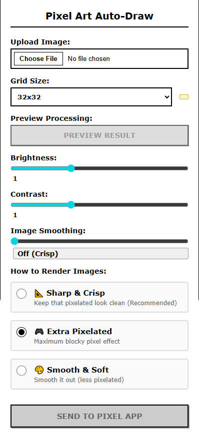

# (Insert Aperture jingle here because I'm not gonna embed a video here)

Hey all, Cave here, and I'm here to introduce you to our newest, biggest (shitpost) invention ever: Aperture Science Pixel Reproducer For E-Ink Devices. (not for E-Ink devices.)

  
Why?

  

 
And, most importantly, this was made thanks to all of our Aperture Science Personality Cores.
 

  
Which one?

  ## Yes. (good job robots)

Now, you might be wondering: "what the hell is this name?". Well, I named this thing after a test subject.

 
Look at him. (cue the aww sfx) Isn't he adorable? (for legal reasons we do not use him as our mascot.)
Alright, we're gonna stop yapping here now.

# So, how do we install this?
Well... this is for anyone with Chromium, as chromium is the fut- WHAT DO YOU MEAN PEOPLE WOULD RATHER RAISE FIREFOXES INSTEAD?
ok, so installation time:
1. Download the repo as a ZIP
2. Wait...
3. 
4. Extract it.
5. Load up chrome://extensions
6. Load up the extracted folder as unpacked extensions
7. Profit.

# Use it.
  

That's it. Besides the "Image Rendering" thing that didn't work (we fired them), all should be working fine.
All good, ready to be relea-
# WHAT DO YOU MEAN I HAVE TO INCLUDE A LICENSE?
Public domain? That sounds good. Anything to make this thing release without complications.

(cue the aperture investment opportunity outro)

# NEW UPDATE!
Merged ~~Black Mesa's~~ @tockdev's code, so that no one has to ever look around to find a copy. It's right here.

# Further updates
Had to make this less confusing, with "Fact Core" helping with why the extension is slow. It's still slow as "Fact Core", during earlier helping sessions, decided to use more "advanced imaging setups" to make it look good, unlike tock's code (as mine has various image sizes while tock only made the userscript as a PoC)

## A Note On The "Crunchy" Image Rendering Issue

Remember when we said "Chromium is the future"? Well, about that. The future has decided that your pixel art renders with what we technical experts call a "delightful crunch." It's not a bug—it's Chrome's gift to you.

See, Chrome takes our nice `image-rendering` CSS property and treats it like a suggestion written on a napkin. "Oh, you want `crisp-edges`? How *adorable*. Let me just render this with my own proprietary anti-aliasing algorithm instead." No amount of CSS patches, canvas wrapping, or sacrificed test subjects will change Chrome's mind. It simply does not care about your pixel art dreams.

We've given up trying to fight the future. The crunchy rendering is now an official feature—a charming reminder that even in 2026, web browsers still can't agree on how to display 8-bit aesthetics.

## Updated integration (v1.2.0)

- Imports directly into the current ReKindle Pixel app state instead of the older message/injector bridge.
- Supports 16×16, 32×32, 64×64, 128×128 and 256×256 imports.
- Adds a **Hide Grid / Show Grid** control to the Pixel editor menu.
- Adds 128×128 and 256×256 choices to the Pixel app's New Drawing dialog.
- Supports ReKindle-hosted Pixel pages, localhost development pages, and local `pixel.html` files (enable **Allow access to file URLs** in extension details).

The importer requires the Pixel editor and its drawing manifest to be ready. It uses the app's own save functions; cloud synchronization still depends on the app's authentication and backend availability.

### v1.2.1
- Restored Pixel's posting button for 64×64, 128×128, and 256×256 drawings. The extension no longer hides the posting control after creating larger drawings.

### v1.2.2
- Fixed the New Drawing size buttons not appearing reliably.
- The extension now inserts 128×128 and 256×256 directly into the New Drawing modal's size row, rather than relying on the 64×64 button as an insertion anchor.
- Keeps 64×64 visible even on Pixel entry routes that hide it by default.
- Re-applies the controls if Pixel rebuilds the modal or editor UI.

### v1.2.3
- Reworked Pixel UI enhancements to follow the two supplied working userscripts directly.
- Runs the enhancements automatically at page load in the Pixel page's MAIN world instead of waiting for the extension popup to open.
- Restores the menu-button retry loop and the drawer script's DOM-ready, delayed retry, and modal observer behavior.
- Keeps posting enabled for 64×64, 128×128, and 256×256 drawings.

### v1.2.4
- Fixed Pixel UI enhancements on KindleChat and other query-string entry links (for example, `?source=kindlechat`).
- The 64×64 button is explicitly restored when Pixel hides it in KindleChat mode.
- 128×128 and 256×256 are inserted into the modal's size row directly, without depending on the 64×64 button as an anchor.
- Content-script matching supports HTTP and HTTPS ReKindle/local development URLs; importer URL validation ignores query strings and URL fragments.
- A DOM observer plus the original retry interval handles late-created/rebuilt Pixel UI.
